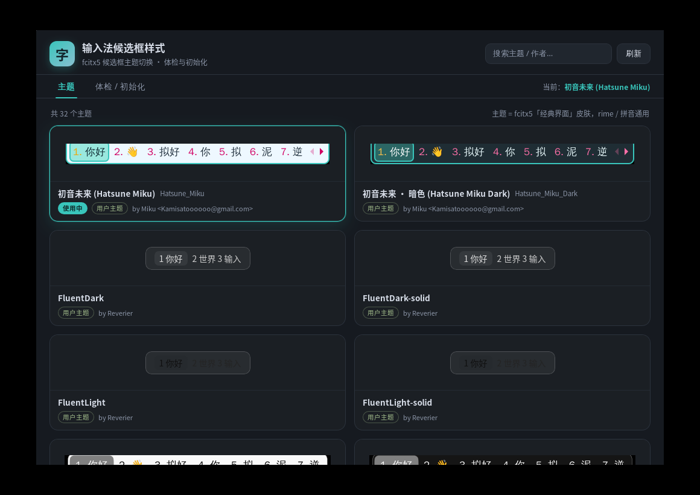
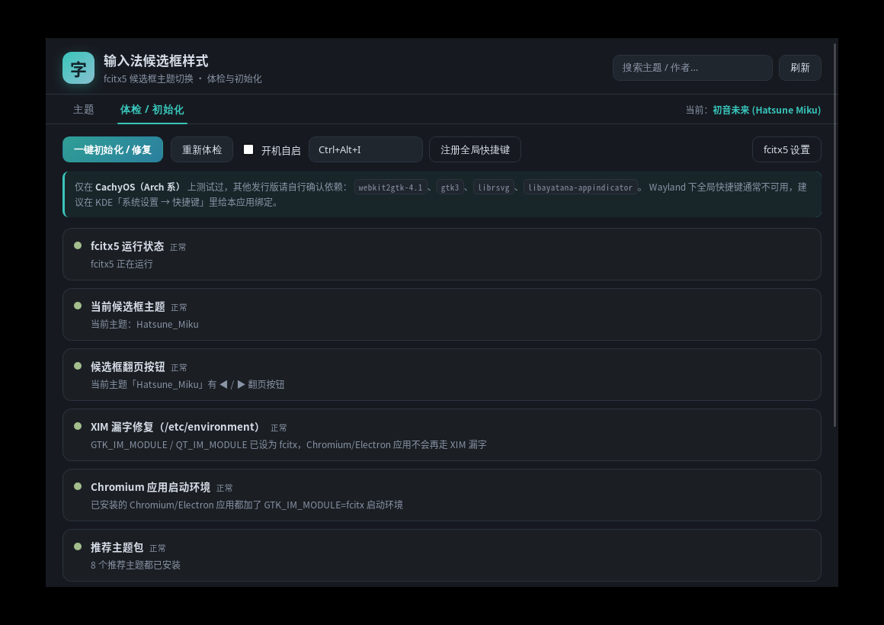

# 输入法候选框样式（ime-theme-switcher）

给 fcitx5「经典界面」候选框换皮肤的 Tauri 小工具，附带一个「体检 / 初始化」页，
把这次折腾 CachyOS 输入法时踩过的坑（XIM 漏字、主题没翻页按钮、主题切换不生效、
Chromium/Electron 应用走错输入法模块等）做成一键修复。

> **测试范围：目前只在 CachyOS（Arch 系，KDE Plasma 6 Wayland）上测试过。**
> Arch / Manjaro / EndeavourOS 等同系发行版理论上可用；其他发行版请自行确认依赖。



体检 / 初始化页：



## 功能

### 主题

- 扫描 `~/.local/share/fcitx5/themes`、`/usr/local/share/fcitx5/themes`、`/usr/share/fcitx5/themes`
- 卡片式展示，每张都是**真实渲染的候选框预览**（隔离 Xvfb 里启动临时 fcitx5，用同一段拼音
  `nihao` 逐主题截图，不是模拟图）
- 点卡片立即切换：只改 `~/.config/fcitx5/conf/classicui.conf` 的 `Theme=` 行
  （**原文件注释和其余配置原样保留**），再调 `qdbus6 … ReloadAddonConfig classicui`
  让 fcitx5 立即重载，无需重启输入法
- 搜索、当前主题高亮、「无翻页按钮」标记、刷新、打开 fcitx5 配置工具

### 体检 / 初始化

| 检查项 | 修复动作 |
| --- | --- |
| fcitx5 是否在运行 | 启动 `fcitx5 -d` |
| 当前主题是否存在 | 回退到可用的默认主题 |
| 当前主题有没有 ◀ / ▶ 翻页按钮 | 换成带翻页按钮的主题（如初音未来） |
| `/etc/environment` 是否有 `GTK_IM_MODULE=fcitx`、`QT_IM_MODULE=fcitx` | 通过 `pkexec` 写入（需管理员授权，全机所有用户生效） |
| ONLYOFFICE / WorkBuddy / Steam 等 Chromium 应用是否加了输入法环境 | 生成用户级 `.desktop` 覆盖（保留原文件内容，仅在 `Exec=` 前加环境变量） |
| 推荐主题是否齐全（初音未来 ×2、PT cute light ×4、Mellow ×2） | 从 GitHub 下载安装；其中「初音未来·暗色」直接内置在程序里，离线也能装 |

「一键初始化 / 修复」会按顺序处理所有可修复项，结果显示在下方日志里。

### 托盘 / 开机自启 / 全局快捷键

- 关闭窗口=收进托盘（托盘菜单：显示窗口 / 退出；左键点图标切换窗口）
- 开机自启开关（静默启动到托盘，`~/.config/autostart/ime-theme-switcher.desktop`）
- 全局快捷键默认 `Ctrl+Alt+I`（呼出/隐藏窗口）
  - **Wayland 下全局快捷键通常注册不上**（X11 可用），失败时应用会提示；
    KDE 用户建议在「系统设置 → 快捷键」里给应用绑定

> 注意：应用本身解决的是「候选框外观 + 输入法环境」；rime 的候选词质量（词库、整句）
> 不归它管，那是输入方案（如雾凇拼音）的事。

## 安装

### 方式 1：pacman 安装包（推荐，Arch / CachyOS）

```bash
# 本地构建（需要 base-devel、rust、webkit2gtk-4.1 等）
cd ~/Projects/ime-theme-switcher
./packaging/arch/build-local.sh          # 产出 packaging/arch/*.pkg.tar.zst
sudo pacman -U packaging/arch/ime-theme-switcher-*.pkg.tar.zst
```

安装后从应用菜单打开「输入法候选框样式」（`/usr/bin/ime-theme-switcher`）。

### 方式 2：用户目录安装（无需 sudo）

```bash
cd ~/Projects/ime-theme-switcher
./install.sh
```

安装到 `~/.local/bin/ime-theme-switcher`，并创建应用菜单项和桌面快捷方式
`~/桌面/输入法候选框样式.desktop`。卸载：`./install.sh --uninstall`。

### 依赖（Arch 系）

```bash
sudo pacman -S webkit2gtk-4.1 gtk3 librsvg libayatana-appindicator polkit curl
# 构建还需要：
sudo pacman -S base-devel rust cargo pkgconf
```

## 命令行

```bash
ime-theme-switcher                         # 打开图形界面
ime-theme-switcher --list-themes           # JSON 列出所有主题
ime-theme-switcher --current-theme         # 当前主题
ime-theme-switcher --apply-theme kagami    # 直接切换主题
ime-theme-switcher --health                # JSON 输出体检结果
ime-theme-switcher --fix cef-launchers     # 执行单个修复项
ime-theme-switcher --fix-all               # 一键初始化
ime-theme-switcher --version
```

## 关于 musl / 静态链接

**做不到真正的 musl 静态二进制**：Tauri 在 Linux 上必须链接系统的 WebKitGTK / GTK
（`webkit2gtk-4.1`、`gtk3`），这些是 glibc 动态库，`x86_64-unknown-linux-musl`
目标无法链接它们。所以本项目的默认产物是 **Arch Linux 的 pacman 安装包**
（`.pkg.tar.zst`，x86_64 / glibc），这也是对 Arch 系用户最省事的安装方式。
如果确实需要跨发行版分发，应改用 Flatpak / AppImage（把 WebKitGTK 运行时带上），
欢迎后续加。

## CI（GitHub / Gitea）

两套工作流内容等价，都在 `archlinux:latest` 容器里构建 pacman 包并上传 artifact：

- GitHub：[`.github/workflows/build.yml`](.github/workflows/build.yml)
- Gitea：[`.gitea/workflows/build.yml`](.gitea/workflows/build.yml)

Gitea 侧说明：需要一台带 Docker 的 act_runner，并把 runner 标签配置为 `ubuntu-latest`
（或把 workflow 里的 `runs-on` 改成你自己的标签）。

## 目录结构

```
dist/                     前端（静态 HTML/CSS/JS，构建时嵌入二进制）
  previews/               每个主题真实渲染的候选框截图
src-tauri/                Rust 后端、Tauri 配置、托盘/快捷键/体检逻辑
  themes/Hatsune_Miku_Dark/  内置的初音未来·暗色主题（离线可安装）
tools/render-previews.sh  重新生成预览图
packaging/arch/           PKGBUILD / 本地打包脚本 / 系统级 .desktop
.github/ .gitea/          CI 工作流
install.sh                用户目录安装 / 卸载
```

## 重新生成预览图

```bash
tools/render-previews.sh   # 需要 xorg-server-xvfb、python3-gi、xdotool、ImageMagick
./install.sh               # 或 cargo build，把新预览图嵌进程序
```

## 致谢与许可

本项目代码 MIT。候选框主题预览/内置主题涉及的上游作品：

- **初音未来主题**：原设计 [Kamisatoooooo](https://kamisatoooooo.github.io/)（CC BY 4.0），
  fcitx5 移植 [FragrantHaze/fcitx5-rime-miku-theme](https://github.com/FragrantHaze/fcitx5-rime-miku-theme)；
  「初音未来·暗色」是在其配色基础上改的暗色变体，同样遵循 CC BY 4.0。
- **PT's cute light**：[Passthem-desu/fcitx5-theme-pt-cute-light](https://github.com/Passthem-desu/fcitx5-theme-pt-cute-light)
- **Mellow themes**：[sanweiya/fcitx5-mellow-themes](https://github.com/sanweiya/fcitx5-mellow-themes)
- fcitx5 / fcitx5-configtool：Fcitx 项目
